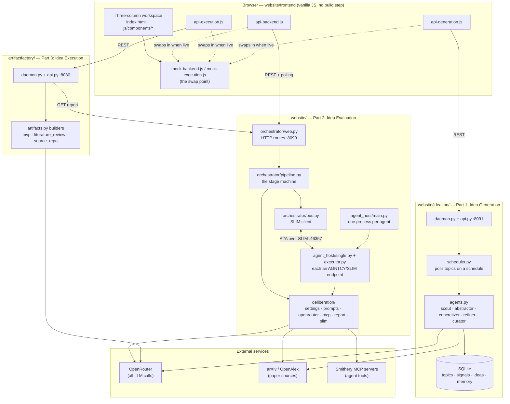
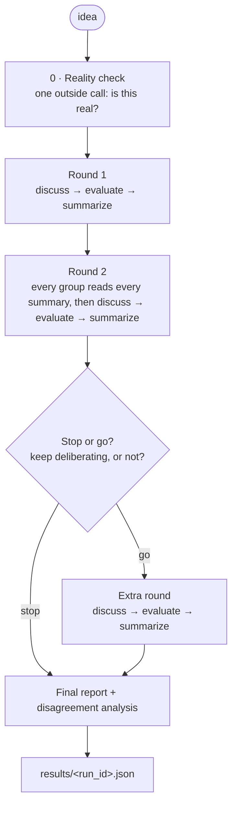
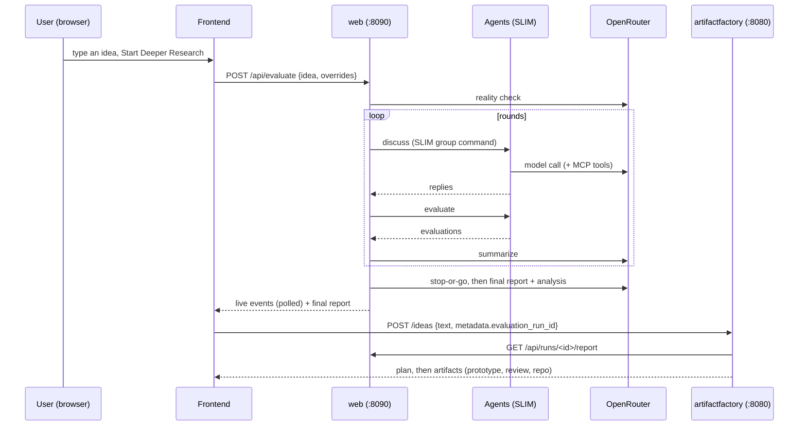

# Architecture

How **AutoInvestigate** (the "Automated Cisco Researcher Thing") is put together:
what the pieces are, how they talk to each other, and where the boundaries sit.

This document describes the system as it exists in the repository. For the
hackathon brief, the product vision and the running notes, see
[`CLAUDE.md`](CLAUDE.md); for per-service detail see the `README.md` inside each
service directory.

---

## 1. What the system does

AutoInvestigate finds emerging technologies and turns them into scored,
implementable ideas. It is a three-stage pipeline, each stage a column in the UI:

| Stage | What happens | Backend | Status |
| --- | --- | --- | --- |
| **1 · Idea Generation** | A daemon watches the internet for a tagged watchlist of topics and a team of agents refines what it finds into ideas; the seed box can also iterate ideas on demand. | `website/ideation/` | Real |
| **2 · Idea Evaluation** | Three groups of AI agents deliberate on one idea and reach a verdict. | `website/` | Real |
| **3 · Idea Execution** | Turn a chosen idea into tangible artifacts (a prototype, a review, a repo). | `artifactfactory/` | Real |

The evaluation stage is the heart of the project: it is a **multi-agent
deliberation** where agents with competing objectives argue, negotiate and
sometimes fail to agree — and the system reports *that* honestly rather than
forcing a consensus.

---

## 2. System overview



**Key idea:** the browser never talks to OpenRouter, arXiv or the agents
directly. All model calls, keys and tool access live on the backend. The
frontend is a thin, static client that discovers whichever backends are running
and falls back to deterministic mocks when they are not.

---

## 3. Repository layout

```
hackathon202610/
  docker-compose.yml        every service, one file (frontend, artifactfactory, slim, agent_host, web)
  run.sh                    run the factory + static frontend locally (no Docker)
  Makefile                  convenience wrappers around the per-directory run.sh scripts
  .env.example              the single root .env template (one OpenRouter key, SLIM secret, Smithery key)

  website/                  ── Part 2: Idea Evaluation ──────────────────────────────
    deliberation/           shared library: settings, prompts, OpenRouter client, MCP client, report builder, SLIM glue
    agent_host/             one process per agent (each a SLIM/A2A endpoint) + the supervisor
    orchestrator/           the pipeline, the SLIM bus client, HTTP routes, frontend compat, live view
    prompts/                every agent role + system prompt (markdown, editable, mounted live)
    schema/                 evaluation-report.schema.json
    frontend/               the three-column app (static, no build step)
    examples/               two finished reports
    tests/                  pipeline, report, compat, sources tests
    setup.sh, Dockerfile, Makefile

  artifactfactory/          ── Part 3: Idea Execution ──────────────────────────────
    daemon.py, api.py       HTTP server + routes
    service.py              ideas → plans → jobs → artifacts
    planner.py, artifacts.py, mvp.py, evaluation.py, storage.py, store.py, models.py, config.py

  evalreport/               Streamlit "Outshift Research Intelligence" app (earlier MVP / report viewer)
  evalreport2/              same evaluation logic as a CLI that writes one self-contained index.html

  deploy/                   Vultr deploy script + notes
  .github/workflows/        CI: deploy on push to main
  documentation/            write-ups, style guide, model notes
```

---

## 4. Part 2 — Idea Evaluation (`website/`)

This is the largest and most interesting part. It takes **one idea string** and
returns a structured report.

### 4.1 The three layers

The backend is deliberately split so that **the orchestrator decides nothing** —
it only relays commands and records what the agents say.

| Layer | Directory | Responsibility |
| --- | --- | --- |
| **Shared library** | `deliberation/` | Settings, prompt loading, the OpenRouter client, the MCP client, the report builder, SLIM glue. Imported by both other layers. |
| **Agent host** | `agent_host/` | Runs one OS process per agent. Each process is a SLIM/A2A endpoint that answers commands. |
| **Orchestrator** | `orchestrator/` | Owns the pipeline, opens SLIM groups, posts commands, collects replies, writes the event log and the report, serves HTTP. |

### 4.2 Why one process per agent

The AGNTCY SDK keeps **one SLIM connection per process**. To give each agent its
own SLIM identity (`deliberation/agents/<id>`), each agent must be its own
process.

- `agent_host/main.py` is a **supervisor**: it reads the settings file every few
  seconds, starts a process per configured agent, restarts any that die, and
  stops ones removed from settings.
- `agent_host/single.py` starts one agent: it builds an A2A server, registers the
  agent card on SLIM, and waits. It patches the SLIM transport so a `SILENT`
  reply is not posted to the group.
- `agent_host/executor.py` is the actual worker. It is **stateless**: every
  command carries everything it needs, and the agent's model, key and role are
  re-read from the shared settings file at command time — so a settings change
  applies to the next command without restarting anything.

### 4.3 Transport — AGNTCY / SLIM

`deliberation/slim.py` holds the glue shared by the host and the orchestrator:
the SLIM server address, the shared secret, the namespace (`deliberation`), the
group (`agents`), and `agent_card()` / `identifier()` helpers.

`orchestrator/bus.py` is the orchestrator's client. One `ask()` call:

1. opens a SLIM group containing the target agents,
2. posts **one** JSON command (`{kind, idea, agents, transcript, …}`),
3. collects the replies as they stream in,
4. closes the group.

The command carries a `cmd` id and a `to` list; each agent answers only if it is
in `to` and the `kind` is one it handles, otherwise it stays silent. This is how
one broadcast reaches a whole group but only the intended members reply.

### 4.4 The pipeline

`orchestrator/pipeline.py` is the stage machine. `orchestrator/run.py` holds the
per-run state (settings snapshot, cost budget, event log, per-group stages).



Each **round** (`round_`) runs the groups concurrently and, within a group, does
three things:

1. **Discuss** — `Run.deliberate()`. Deep mode is a timed round-robin: agents
   speak one at a time in a shuffled order, each hearing everything said so far,
   for a configurable number of seconds (every agent speaks at least once). Quick
   mode (`_deliberate_together`) has everyone speak at once in a single group
   command.
2. **Evaluate** — `Run.evaluate()`. Every agent writes its evaluation at the same
   time. Round 1 uses the agent's own role format; later rounds use the shared
   evaluation template (`cross_review`).
3. **Summarize** — `summarize()`. A summarizer model writes each group's pros and
   cons.

The **stop-or-go** step (`stop_or_go`) decides whether to keep deliberating — it
is *not* a verdict on the idea. It can stop, or run one extra round and then
always finish. If consensus across groups is not feasible, the disagreement is
kept.

The **final report** (`conclude`) is written by its own stage and model. It is
fed the **raw material** — each group's latest evaluations in full, the latest
discussion, the arXiv papers, the stop-or-go decision and the reality check — not
just the twice-squeezed summaries. It returns a structured verdict: headline,
recommendation, executive summary, the idea as evaluated, case for/against, an
ordered action plan, kill criteria, risks, open questions, and what would change
the verdict.

The **disagreement analysis** (`orchestrator/analysis.py`) runs alongside the
final report: one model call proposes disagreements and agreements, then **every
quote is checked word-for-word against what the cited agent actually said**.
Unverifiable quotes are dropped and counted, so the report never shows an
invented quote.

### 4.5 The reality check

Before any group deliberates, one outside call (`reality_check`) asks whether the
idea makes sense in the real world at all — coherent and physically, legally and
logically possible. It returns `grounded` / `questionable` / `nonsense` plus a
category, summary, real-world blockers and shaky assumptions.

It is **advisory**: if the call fails the run continues without it. Its result
feeds the stop-or-go and final prompts (so a `nonsense` idea cannot get a plain
"Go") and is shown to the user as a banner. It is the guard against a bad idea
slipping through: the three groups all argue *inside* the idea, so none of them
steps outside to ask whether it is real.

### 4.6 arXiv sources

`orchestrator/sources.py` gives the research and private-equity groups a handful
of relevant arXiv papers:

1. a cheap model writes 3 keyword queries,
2. **OpenAlex** (restricted to arXiv) is searched — the arXiv API itself
   rate-limits hard and is only the fallback,
3. a cheap model keeps the most relevant papers,
4. results are cached per idea in `data/sources_cache.json`.

Agents must cite as `[arXiv:ID]`, and `deliberation/report.py` checks every
citation against the list, recording unknown citations.

### 4.7 MCP servers (agents can use tools)

Each agent carries `mcp_servers`: ids from `MCP_CATALOG` in
`deliberation/defaults.py`, curated from [Smithery](https://smithery.ai/servers)
across three categories — Academic Research, Finance and Reasoning.

During the `evaluate` / `cross_review` stages (deep mode only), the agent host
connects to the agent's servers over Streamable HTTP (`deliberation/mcp.py`),
lists their tools, and offers them to the model via OpenRouter tool-calling
(`deliberation/openrouter.py` `chat_with_tools`). Tool names are prefixed with
the server id (`arxiv__search`) so two servers can expose the same name. It is
bounded by `mcp.max_tool_calls` and **fail-safe**: if a server is down or a call
fails, the agent answers without tools.

The Smithery key comes from `SMITH_API_KEY` in the root `.env`; a stored
`mcp.api_key` is only a fallback.

### 4.8 The OpenRouter client

`deliberation/openrouter.py` is the single place every model call goes through:

- **Cost tracking** — every call reports its cost; a per-run `RunBudget` sums it
  and raises `BudgetExceeded` when the cap is reached.
- **Reasoning control** — reasoning models can spend the whole token limit on
  hidden thinking and return nothing, so every call sets a reasoning effort, and
  an empty answer that was cut off is retried once with reasoning off and a
  bigger limit.
- **Retries** — transport errors and retryable HTTP statuses back off and retry.
- **Web search** — a `:online` model suffix is turned into an explicit web plugin
  so the number of search results (and thus the cost) is ours to set.
- **JSON** — `chat_json` retries until the reply holds a JSON object that passes
  a caller-supplied validator; `extract_json` finds the first balanced object
  even through code fences and chatter.
- **Tools** — `chat_with_tools` runs the tool-call loop and sums the cost of
  every round.

### 4.9 Settings

`deliberation/settings.py` is the settings store. Keys live in
`data/settings.json` (gitignored, mode 600) and are **masked** in the public view
sent to a browser. `deliberation/defaults.py` defines the defaults: the three
group perspectives, their agents, the MCP catalog, and the stage configuration.

Settings cover: mode (quick/deep), arXiv sources, the default OpenRouter key,
deliberation time, cost cap, web search, a per-stage token/effort table, the
summarizer / judge / final / reality-check models and keys, the MCP settings, and
the group perspectives (name, discussion style, arXiv use, and each agent's
model, key, reasoning effort, prompt and MCP servers).

The default group perspectives:

| Perspective | Default agents | Focus |
| --- | --- | --- |
| **Professional Research Group** | 4 | Stage of research, feasibility to scale, long-term-only implementations. |
| **Private Equity / Business** | 4 | PE partners maximizing returns; one per criterion: tech risk, market, cisco_fit, horizon. |
| **Market Reaction** | 5 (+ archetypes) | The people being served (customer archetypes). They do **not** naturally reach consensus. |

A group's **discussion style** is `converge`, `diverge`, or `auto`. `auto` lets
the backend pick: `diverge` for groups of customer archetypes, `converge` for
groups of specialists working toward a shared view (`prompts.resolve_consensus`).

### 4.10 Prompts

Every prompt is a markdown file under `website/prompts/`, mounted live into the
container. `deliberation/prompts.py` loads and renders them; templates use
`<<NAME>>` placeholders (JSON braces stay literal), and a missing placeholder is
an error, not a silent blank.

```
prompts/
  system/     the stage prompts: deliberation, evaluation, cross_review, summarize,
              stop_go, final, reality_check, analysis, sources_queries, sources_rank,
              evaluation_template, consensus_instructions
  research/   the four research agents' role documents
  private_equity/  the four PE partners
  market/     the market archetypes (power_user, enterprise_decision_maker, …)
```

### 4.11 The report and its schema

`deliberation/report.py` turns a run's event log into the report. Everything
there is **deterministic** — it only reshapes and parses what the agents wrote.
The one model-made part, the disagreement analysis, is read from the run's
`analysis` event.

The report conforms to `website/schema/evaluation-report.schema.json`. Top-level
sections: `run` (metadata, cost, mode), `pipeline`, `groups` (agents, rounds,
discussions, evaluations, summaries, scores, verdicts, disagreements),
`cross_group`, `stop_go`, `verdict` (the final report), `reality_check`, `complex`
(the Evaluation Complex's stewards and votes), `agntcy`
(transport/protocol/endpoints), `analysis`, and `sources`.

### 4.12 HTTP routes

`orchestrator/web.py` is a `ThreadingHTTPServer` with one event loop and one SLIM
client for the life of the process. It serves both the JSON API and the static
frontend.

| Route | Purpose |
| --- | --- |
| `POST /api/evaluate` | Start a run (up to `MAX_PARALLEL`, default 3). Accepts `overrides` (mode, deliberation seconds, summarizer model, group ids). |
| `POST /api/stop` | Cancel a run (or all running runs). |
| `GET /api/status`, `GET /api/runs` | What is running (with the number of active agents); past runs. |
| `GET /api/runs/<id>/events?since=N` | Raw event log. |
| `GET /api/runs/<id>/report` | The report (schema-conforming). |
| `GET /api/ui/runs/<id>/events?since=N` | Live events in the frontend's shape (`orchestrator/compat.py`). |
| `GET /api/results` | Index of exported reports. |
| `GET`/`PUT /api/settings`, `POST /api/settings/reset` | Settings (keys masked). |
| `GET /api/models` | OpenRouter models with prices (cached). |
| `GET /api/prompt?path=…` | Read a prompt file. |
| `GET /`, `/live`, `/settings` | The frontend, the three-column live view, the bare settings page. |

`orchestrator/compat.py` translates the raw event log into the event kinds the
frontend renders (`phase`, `cluster`, `reality-check`, `group-start`,
`round-start`, `turn`, `missed`, `evaluation`, `failed`, `summary`, `cross-group`,
`stop-go`, `verdict`).

### 4.13 The live view

`orchestrator/static/index.html` is the backend-served **Agent View**
(`http://localhost:8090/live`): three live chat columns, a stage tracker and a
replay control, good for demos. It renders the same shared navbar as the rest of
the app (it loads the frontend's CSS and shell scripts).

---

## 5. Part 3 — Idea Execution (`artifactfactory/`)

A small, self-contained Python daemon (**standard library only**) that turns a
validated idea into tangible artifacts. It is the backend for the frontend's
third column.

```
POST /ideas ──► Idea ──► Plan (artifact_specs) ──► POST /plans/{id}/implement ──► Job ──► Artifacts
```

- `service.py` orchestrates: create idea → create plan → run a job in a thread →
  build each artifact spec in order.
- `planner.py` builds the plan. The default plan is `source_repository` →
  `npm_package` → `docker_image` → `literature_review` → `tarball`; the frontend
  asks only for `mvp_prototype`.
- `artifacts.py` is a **registry of builders** keyed by artifact type. Each
  builder writes files through the storage backend.
- `storage.py` is pluggable: `local` (default) or an `s3` skeleton (lazy
  `boto3` import).
- `store.py` is a thread-safe JSON document store with atomic persistence
  (`state.json`); jobs are in-memory.
- `config.py` anchors defaults to the project root so artifacts always land in
  the same place.

**Real content from the evaluation report.** When an idea arrives with
`metadata.evaluation_run_id` (the frontend's **Execute →** sends it),
`evaluation.py` fetches that run's report from the evaluation backend
(`AF_EVAL_API`) and builds:

- `literature_review` — the arXiv papers the agents were given (and who cited
  each), every group's verdict, scores, pros and cons, verified disagreement
  quotes, open questions, and a short related-work synthesis whose citations are
  checked against the paper list.
- `source_repository` (Python) — a README with the experiment the panel asked for
  and a starter `experiment.py`, syntax-checked before it is saved.
- `mvp_prototype` — one self-contained, interactive HTML page (`mvp.py`) showing
  the idea's narrow first version as a clickable product, with the evaluation
  panel's concerns built in.

**Safety.** The prototype page may not load or send anything: external scripts,
stylesheets, frames and links are stripped, network APIs are refused, and a
strict Content-Security-Policy is injected. `GET /artifacts/{id}/view` serves it
with that policy plus `sandbox allow-scripts`, and the frontend shows it in a
sandboxed iframe. If generation fails, a plain page is built instead, so a build
never fails because of this.

Every step degrades gracefully: no run id, no backend, no key or a model error
falls back to deterministic placeholder output.

---

## 6. Frontend (`website/frontend/`)

**No build step.** Vanilla JS, classic `<script>` tags, a single `window.Hack`
namespace. Open `index.html` directly or serve it.

### 6.1 Layout

Three columns, one per pipeline stage:

| Column | Component | Purpose |
| --- | --- | --- |
| **1 · Idea Generation** | `components/generation.js` | Seed box + the level tree of ideas. |
| **2 · Idea Evaluation** | `components/evaluation.js` | Selected ideas + deeper-research runs. |
| **3 · Idea Execution** | `components/execution.js` | Turn a chosen idea into artifacts. |

The header is a **navbar** — one shared component (`components/navbar.js`)
mounted on every page, so it looks and behaves the same everywhere. The workspace
mounts it from `app.js`; other pages mount it (and the popups it opens) from
`shell.js`.

### 6.2 State and rendering

`state.js` is the single source of truth plus a tiny pub/sub. `actions.js` holds
all mutations and orchestration. Components expose `mount(container)` and
`render()`; `app.js` subscribes to the store and calls every component's
`render()` on change.

Conventions:

- Inputs mutate state directly **without** notifying (to avoid re-render on
  keystrokes); structural changes call `store.notify()`.
- `preserveView()` restores focus/scroll across re-renders.
- The mock output is **deterministic per idea** (seeded PRNG), so the same idea
  always yields the same mock result.

### 6.3 The mock → real swap

`mock-backend.js` and `mock-execution.js` are the **single swap points**. The
real clients replace their functions in place, so the UI code never changes:

- `api-backend.js` connects Part 2 to `website/` when it answers (same origin on
  :8090, or `localhost:8090` from `run.sh` on :8000). It starts a run, polls
  `/api/ui/runs/<id>/events`, and loads the report when the run finishes. It also
  fills the settings popup with the backend's real groups and models and loads
  past runs.
- `api-execution.js` connects column 3 to `artifactfactory/` (same origin, or
  `localhost:8080`). It creates ideas, implements plans, polls jobs and lists
  artifacts.

Both discover their backend themselves and fall back to the mock when nothing
answers. The navbar's **MOCK BACKEND** badge and the **Agent View** link follow
the detected backend via `Hack.backendInfo`.

### 6.4 Settings

Settings is a **popup**, opened from the header — the one settings surface. When
the backend is connected it renders the backend's real settings and saves them
with `PUT /api/settings`; without a backend it falls back to the in-memory mock
settings. The MCP server catalog lives here too.

### 6.5 Design principles

Light mode only; minimal styling; plain layout, thin borders, system font;
HTML5 named colors used sparingly (`silver`, `gray`, `gainsboro`, `whitesmoke`,
`aliceblue`, `green`, `red`, `darkorange`, `blue`). No hex colors, gradients,
shadows or blur. The full design system lives in `STYLE.md`; the canonical
implementation is `css/styles.css`.

---

## 7. Data flow, end to end



---

## 8. Configuration and environment

Everything runs on a **single OpenRouter key** in one root `.env` (template:
`.env.example`):

| Variable | Purpose |
| --- | --- |
| `OPENROUTER_API_KEY` | Every model call, in every service. |
| `SLIM_SHARED_SECRET` | The AGNTCY/SLIM bus secret. |
| `SMITH_API_KEY` | Optional; the Smithery key for the agents' MCP servers. |
| `SLIM_SERVER`, `HOST_UID`, `HOST_GID` | Set by `setup.sh` for Docker. |

There are no per-directory `.env` files and no other provider keys. Each service
reads that one file: the evaluation backend via `env_file: .env` in
`docker-compose.yml`, `evalreport/` via `load_dotenv(<repo-root>/.env)`, and
`artifactfactory/run.sh` sources it.

Keys stay on the backend and are masked in every public view.

---

## 9. Running and deployment

| Service | Host URL | What it is |
| --- | --- | --- |
| `frontend` | http://localhost:8000 | Static three-column workspace (no build step). |
| `artifactfactory` | http://localhost:8080 | Artifact Factory REST API — column 3. |
| `web` (+ `slim`, `agent_host`) | http://localhost:8090 | Evaluation backend — column 2. |
| `ideation` | http://localhost:8091 | Ideation collective daemon — column 1 (topics, monitoring, idea generation). |
| `evalreport` | http://localhost:8501 | Streamlit "Outshift Research Intelligence" app. |
| `slim` | :46357 | The AGNTCY/SLIM bus. |

- **Docker (everything):** `cp .env.example .env`, set the key, then
  `docker compose up --build`.
- **Evaluation backend alone:** `cd website && ./setup.sh` — checks Docker, writes
  the root `.env`, builds and starts SLIM + one agent process per evaluator + the
  web app, waits until every agent is registered, then sends one tiny call to
  each model.
- **No Docker:** `./run.sh` runs the factory daemon and the static frontend; the
  frontend finds the evaluation backend at `localhost:8090` if it is running.
- **Deploy:** `deploy/remote-deploy.sh` runs on a Vultr droplet; GitHub Actions
  (`.github/workflows/deploy.yml`) copies it over SSH and runs it. Nothing is
  built on the runner — the droplet builds the images.

---

## 10. Testing

| Where | What |
| --- | --- |
| `website/tests/` | Pipeline control flow, report parsing, quote verification, compat shapes, sources, the OpenRouter client. `make test` (needs `uv`). |
| `artifactfactory/tests/` | The factory's unit tests. `make tests`. |
| `website/scripts/live_smoke.py` | One tiny call to every configured model (run by `setup.sh`). |
| `website/scripts/benchmark_vs_baseline.py` | The multi-agent deliberation vs. one plain model call. |
| `make js`, `make components`, `make css` | Syntax-check the frontend JS and CSS. |

---

## 11. Design decisions worth knowing

- **The orchestrator decides nothing.** It opens SLIM groups, relays commands and
  records events. All thinking is done by the agents and the summarizer / judge /
  final models. This keeps the pipeline testable without SLIM.
- **One process per agent** because the AGNTCY SDK holds one SLIM connection per
  process.
- **The frontend is a thin, static client.** No build step, no keys, no direct
  model access. It discovers backends and degrades to deterministic mocks.
- **The mock is the contract.** `mock-backend.js` documents the exact shapes the
  UI expects; the real clients swap in behind it.
- **Everything degrades.** The reality check, source finding, MCP tools, the
  disagreement analysis and every artifact builder are fail-safe: a failure
  never breaks the run.
- **Quotes are verified.** The report never shows a quote that was not actually
  said — unverifiable quotes are dropped and counted.
- **Stop-or-go is not a verdict.** It decides whether to keep deliberating; the
  idea's verdict is the final report's headline.
- **Consensus is not always the goal.** The system is built to keep a
  disagreement and ask a human when the groups cannot converge.

---

## 12. Status and known gaps

**Real:** Part 1 (ideation) — the daemon, the SQLite store, the topic watchlist,
the source adapters, the collaborative agent team, the memory, the Ideation View
and the Part 1 generation contract. Part 2 (evaluation) end to end — the pipeline,
the reality check, the final report, arXiv sources, MCP tools, the report schema,
the live view, the settings page. Part 3 (execution) — plans, jobs, the MVP
prototype, the literature review and the source repository built from a run's
report.

**Mocked / not done:**

- **Ideation scheduling** — the daemon polls on a fixed interval; there is no
  per-topic cadence, back-off or retention policy for the signal firehose yet.
- **Settings persistence** in the frontend mock is in-memory only (the backend
  settings do persist).
- **Prompt selection** — prompts are loaded from the filesystem and editable, but
  the "selectable prompt set" idea is only partly realised.
- The factory's `npm_package`, `docker_image` and `tarball` builders are still
  placeholders.

**Open questions** (from `CLAUDE.md`): whether selection should be scoped per
level; whether the level tree should show parent/child links; and what the
spec's unspecified "third part" of the backend is.

---

## 13. Part 1 — Idea Generation (`website/ideation/`)

The **ideation collective**: a long-running daemon that watches the internet for a
tagged watchlist of topics and turns what it finds into ideas. It is the real
backend for the frontend's first column, and it reuses `deliberation/` as its
shared library (the OpenRouter client, the prompt loader, settings) exactly as
`orchestrator/` and `agent_host/` do.

```
website/ideation/
  daemon.py       entrypoint (argparse + Config.from_env + serve)
  api.py          ThreadingHTTPServer: JSON API + the Ideation View page
  config.py       Config dataclass + from_env (ID_* env vars)
  store.py        the SQLite store (topics · signals · ideas · sessions · events · memory)
  topics.py       the default tagged watchlist
  sources.py      source adapters: arXiv · Hacker News · Reddit · news RSS
  agents.py       the collaborative team + the message schema
  memory.py       the curated memory and its retrieval
  service.py      orchestration: a cycle (poll) and a session (refine)
  scheduler.py    the background loop that runs cycles
  prompts/        the agent role prompts + the shared message format
```

### 13.1 The two loops

- **A cycle** (`Service.run_cycle`) polls every enabled topic's sources, stores
the new signals (deduplicated by a hash of the URL/title), and runs a session for
any topic that found something new. The `scheduler.py` thread runs a cycle every
`poll_interval_seconds` (default 900).
- **A session** (`Service.run_session`) is the refinement: a team of agents reads a
topic's newest signals and works **together** — not in competition — to refine them
into one idea.

### 13.2 The team and the message format

Three agents, each with its own prompt and model: **Idea Generator** (given a
description of the idea, does extra research and produces a more finalized idea — or
a completely different one), **Builder** (scores how well the idea can be built as an
MVP or artifact), and **Analyzer** (researches the idea and judges whether it makes
sense or is nonsense). They speak in a fixed order, round by round, each building on
what the others said.

Every message has the same shape, enforced by `agents.validate_message`:

| Field | What it is |
| --- | --- |
| `context` | **Large** text: the background, the reasoning, and the text of the websites/signals that were read. |
| `idea` | The idea itself — **one sentence** only. |
| `justification` | **3-4** bullet points on why it is a good idea. |
| `sources` | The links the message drew on. |

The **Builder** adds a `build` score (`mvp`, `artifact`, `effort`, `blockers`); the
**Analyzer** adds an `analysis` verdict (`makes_sense` / `questionable` / `nonsense`,
with `confidence`, `findings`, `blockers`). Any agent may add `memory` proposals; only
those with importance ≥ 7 are promoted (the "VERY IMPORTANT" filter).

### 13.3 The store and the memory

`store.py` is SQLite (one file, `ideation.db`, on a Docker volume) because the
signal firehose is append-heavy and needs cheap dedup, and because the daemon is
multi-threaded. Collections: `topics`, `signals`, `ideas`, `sessions`, `events`,
`memory`. The **memory** is not a log — it holds only the durable, high-signal
findings, and it is retrieved (by tag/keyword overlap) before a session so the team
remembers what it learned.

### 13.4 The Ideation View and the frontend

`website/frontend/ideation.html` + `js/ideation.js` is the **Ideation View** (the
navbar's **Research and Ideation** link, also served by the daemon at `GET /`). It is
three columns: **Topics** and **Sessions** side by side (each scrolls independently)
and the **main view** to their right, with **Session / Ideas / Memory** tabs. Clicking
a session shows it in the main view. A session is drawn as an **agent graph — the same
visual language as the Evaluation Swarm** — with the selected agent's messages beside
it (the large context is collapsible, the one-sentence idea and its bullets are shown,
and the Builder's score and the Analyzer's verdict are rendered as chips). At the end
of the topics list is a long **+ Add Topic** button: the user describes a topic and
`POST /api/topics/draft` has a model fill in the name, description, tags and keywords
(editable before it is added).

`js/api-generation.js` connects the workspace's first column to the daemon: the
seed box's `generateIdeas` calls `POST /api/generate` (the Part 1 contract), and
the ideas the daemon has already generated are loaded from `GET /api/tree` into the
same level tree (`generation.js`) — abstract ideas at level 1, concrete at level 2.

### 13.5 Routes

| Route | Purpose |
| --- | --- |
| `GET /` | The Ideation View page. |
| `GET /info`, `GET /health` | Service info; health. |
| `GET`/`POST /api/topics`, `PUT`/`DELETE /api/topics/{id}` | The watchlist. |
| `POST /api/topics/draft`, `POST /api/topics/discover` | Draft a topic from a description; run the topic finder. |
| `GET /api/ideas`, `GET /api/ideas/{id}`, `GET /api/tree` | Generated ideas; the level tree. |
| `GET /api/signals`, `GET /api/memory` | The raw feed; the memory. |
| `GET`/`POST /api/sessions`, `GET /api/sessions/{id}` | Refinement sessions. |
| `GET /api/sessions/{id}/events?since=N`, `GET /api/sessions/{id}/report` | The live stream; the report. |
| `POST /api/generate` | The Part 1 generation contract. |
| `POST /api/poll`, `GET /api/status` | Run a cycle now; daemon status (incl. `running_agents`). |
| `GET`/`PUT /api/settings` | The daemon's settings (persisted next to the database). |

### 13.6 Configuration

| Env var | Default | Meaning |
| --- | --- | --- |
| `ID_HOST`, `ID_PORT` | `127.0.0.1`, `8091` | Bind host and port. |
| `ID_DATA_DIR` | `<repo>/_ideation-data` | Where `ideation.db` lives (a Docker volume). |
| `ID_FRONTEND_DIR` | `<repo>/website/frontend` | Where the Ideation View page lives. |
| `ID_POLL_INTERVAL` | `900` | Seconds between cycles. |
| `ID_MAX_COST` | `0.50` | Per-session / per-cycle cost cap. |
| `ID_AUTOSTART` | `1` | Start the scheduler with the daemon. |
| `ID_MODEL` | `openai/gpt-oss-120b` | Default model for the agents. |

The daemon's settings are editable from the **Settings** button in the Ideation View
(`GET`/`PUT /api/settings`, persisted to `_ideation-data/settings.json`). They cover a
**default model** plus a **per-agent model** for each of the three agents (a per-agent
choice overrides the default), the **topic drafting model** used by **+ Add Topic**, a
**Thinking** toggle per model (reasoning on/off), and the poll interval, cost cap,
refinement rounds, signals per session and autostart.

In Docker the daemon is the `ideation` service (built from `./website`, command
`python -m ideation.daemon`, port `8091`), and `./_ideation-data` is mounted as a
volume so the database survives a rebuild. Because Docker creates a missing
bind-mount directory as `root`, the service starts as root and runs
`website/docker-entrypoint.py`, which chowns the data directory to
`HOST_UID:HOST_GID` and then drops to that user — so the database is owned by you
on the host.
