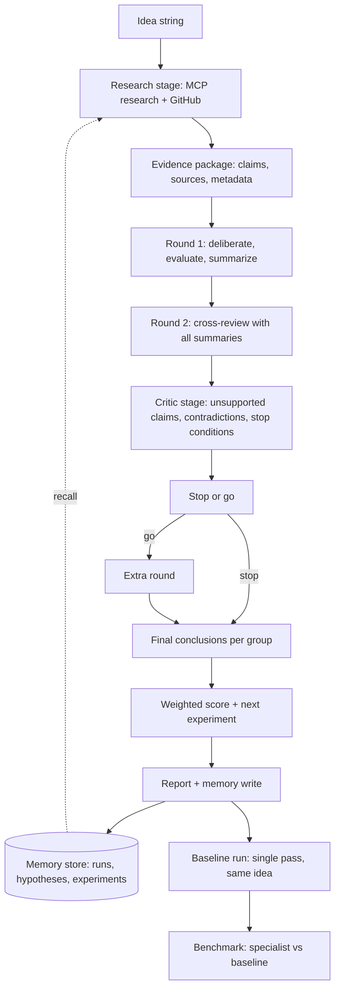

# Improving the evaluation backend with the ideas in `MCP_INFO.md`

Research note. It maps the MCP-based "research-to-prototype" design in
[`../MCP_INFO.md`](../MCP_INFO.md) onto the existing Part 2 backend, finds the real gaps, and
proposes a concrete, phased way to close them without disturbing what already works.

Read `README.md` and `CLAUDE.md` first; this document assumes them.

---

## 1. Thesis

The backend today is a **pure deliberation engine**: agents reason from their own priors, talk to
each other over AGNTCY/SLIM, and a judge decides whether to keep talking. It is strong at the part
the hackathon cares about most (genuine disagreement, a real negotiation mechanism, a stop-or-go
decision, a baseline-free verdict) and weak at the part `MCP_INFO.md` is about: **grounding the
deliberation in retrieved evidence, remembering what was learned, and proving it beats a simpler
baseline.**

`MCP_INFO.md` proposes exactly those missing pieces — MCP tool servers (research, GitHub, memory),
a research agent that gathers evidence *first*, a shared evidence package, an independent critic, a
consensus/scoring layer, sandboxed prototype experiments, and a baseline comparison. None of them
require rewriting the pipeline. They slot in as **one new tool layer, two new stages, and one new
memory store**, all of which the current event-log/report architecture already accommodates.

The single highest-value change is the **evidence stage**: retrieve sources before the first round
and inject them into every agent's prompt. It directly satisfies the challenge's "effect of new
information" criterion, it turns the existing quote-verification machinery in
`orchestrator/analysis.py` into *source* verification, and it is the cheapest way to make the
verdicts defensible.

---

## 2. What `MCP_INFO.md` actually proposes

Distilled into capabilities (section numbers refer to `MCP_INFO.md`):

| # | Capability | Where in `MCP_INFO.md` |
|---|---|---|
| C1 | **MCP tool connectivity** — connect to local (stdio) or remote (HTTP) MCP servers, `list_tools()`, inspect schemas, call read-only tools | §5, §6, §11 |
| C2 | **Research-first evidence** — a research agent gathers papers/docs/repos into a shared evidence package *before* specialists evaluate | §7 |
| C3 | **Three specialist lenses** — Business, Venture Capital, Technical, each scoring 1–5 on fixed criteria | §8 |
| C4 | **Independent critic** — unsupported claims, contradictions, failure scenarios, stop conditions | §7, §8 |
| C5 | **Consensus/scoring** — weighted overall score (Business 30 / VC 25 / Technical 45), disagreements, confidence, next experiment | §8, §9 |
| C6 | **Persistent memory** — store assessments, retrieve prior experiments, track which hypotheses passed/failed | §5C, §14 |
| C7 | **GitHub inspection** — search repos, read READMEs/source, find dependencies and examples | §5B |
| C8 | **Sandboxed prototype** — run generated code in a restricted sandbox, record measured results | §12, §14 |
| C9 | **Baseline comparison** — specialist workflow vs a general-purpose baseline on identical objectives, blind human review | §13 |
| C10 | **Security rules** — untrusted retrieved content, read-only GitHub, argument validation, timeouts, no secrets in logs | §12 |
| C11 | **AGNTCY interoperability** — optional, later | §14 |

The backend already has C11 (AGNTCY/SLIM is its transport). It has partial versions of C3, C4, C5.
It has essentially none of C1, C2, C6, C7, C8, C9, C10.

---

## 3. What the backend has today (grounded)

| Area | Where | State |
|---|---|---|
| Pipeline | `orchestrator/pipeline.py` | `round_()` = deliberate → evaluate → summarize; `stop_or_go()`; `conclude()`; `analyze()` |
| One run | `orchestrator/run.py` | `Run.deliberate()` (timed round-robin), `Run.evaluate()`, `Run.log()`, `RunBudget` |
| Transport | `orchestrator/bus.py`, `council/slim.py` | one SLIM group per command, A2A messages, replies collected |
| Agent process | `agent_host/executor.py` | builds a prompt from `prompts.system(...)` and calls `orr.chat` |
| Model client | `council/openrouter.py` | `chat`, `chat_json`, retries, reasoning effort, `:online` web search, budget |
| Prompts | `prompts/system/*.md`, `prompts/<group>/*.md` | `<<PLACEHOLDER>>` templates, editable, mounted live |
| Settings | `council/settings.py`, `council/defaults.py` | groups/agents/models, stages, budget; keys server-side |
| Report | `council/report.py`, `schema/evaluation-report.schema.json` | deterministic reshape of the event log |
| Disagreement analysis | `orchestrator/analysis.py` | one model call + **word-for-word quote verification** |
| Live UI | `orchestrator/compat.py`, `orchestrator/static/` | event kinds the frontend renders |
| Tests | `tests/` | pipeline control flow, report parsing, quote verification, compat shapes |

Two relevant facts:

- **Retrieval exists but is uncontrolled.** `:online` models do a web search inside the model call
  (`council/openrouter.py` `_body`), but the backend never sees the sources, cannot verify them, and
  cannot share them between agents. That is the opposite of `MCP_INFO.md`'s "return source URLs and
  publication metadata".
- **Verification exists but only for agent quotes.** `analysis.verify()` already drops quotes that
  do not appear word-for-word in what the cited agent said. The same idea extends naturally to
  external sources — this is the cheapest credibility win in the repo.

---

## 4. Gap analysis

| Capability | Backend today | Gap | Proposed fix |
|---|---|---|---|
| C1 MCP tools | none | no tool layer at all | `council/mcp.py` client + `mcp_servers` in settings |
| C2 Evidence-first | none | agents reason from priors | `orchestrator/evidence.py` stage + `<<EVIDENCE>>` in prompts |
| C3 Specialists | 3 groups, 13 agents, per-metric medians | criteria not weighted into one number | deterministic weighted score in `report.py` |
| C4 Critic | `critical_reviewer` inside research group; `analysis.py` finds disagreements | no cross-group red-team stage | `prompts/system/critic.md` + `Run.critic()` |
| C5 Consensus | `stop_or_go` judge + `final` verdict | no transparent weighted score, no next-experiment field | weighted score + `next_experiment` in report |
| C6 Memory | `council_results/` is a write-only archive | nothing is read back into new runs | `council/memory.py` (local) or memory MCP |
| C7 GitHub | none | no repo inspection | GitHub MCP via C1 |
| C8 Sandbox | `artifactfactory/` exists but is separate and dummy | no measured experiment | wire artifactfactory + a sandbox runner |
| C9 Baseline | `evalreport/` has a baseline | backend has none | `orchestrator/baseline.py` + benchmark harness |
| C10 Security | keys server-side, budget cap, timeouts | no untrusted-content handling, no read-only policy, no audit | policy in `council/mcp.py` + settings |

---

## 5. Proposed architecture



The orchestrator keeps its role: it opens SLIM groups, relays commands, records events, and decides
nothing. The research and critic stages are **gatherers and challengers, not deciders**, so the
"no central decision-maker" property is preserved. The only judgement calls remain the existing
`stop_or_go` and `final` stages.

### 5.1 New module: `council/mcp.py` (C1, C7, C10)

A thin, provider-agnostic MCP client. It connects to servers configured in settings, lists tools,
and calls them under a strict policy. Sketch:

```python
"""MCP tool client. Connects to configured servers, lists tools, calls them under a policy."""
import asyncio, json
from dataclasses import dataclass

@dataclass
class Server:
    id: str
    transport: str          # "stdio" | "http"
    command: str = ""       # stdio: executable
    args: list[str] = None  # stdio: argv
    url: str = ""           # http: endpoint
    read_only: bool = True
    timeout_s: float = 20.0
    max_bytes: int = 200_000

class MCPClient:
    async def list_tools(self, server: Server) -> list[dict]: ...
    async def call(self, server: Server, tool: str, args: dict) -> dict:
        """Validate args against the tool schema, enforce timeout and size cap,
        return {"content": ..., "sources": [...], "server": ..., "tool": ...}."""
```

Policy rules, straight from `MCP_INFO.md` §12:

- **Read-only by default.** A server must be explicitly marked writable to call a mutating tool.
- **Allowlist tools.** Only tools named in settings are callable.
- **Validate arguments** against the tool's input schema before calling.
- **Timeout and size cap** every call; a slow or huge response is dropped, not waited on.
- **Treat retrieved text as untrusted.** Never execute instructions found in retrieved content;
  wrap it in a clearly delimited block and tell the model it is data, not instructions.
- **Audit without secrets.** Log server, tool, args hash, byte count, duration, and errors — never
  keys or full retrieved bodies.

Dependency: add `mcp` (the Python SDK, `mcp[cli]`) to `pyproject.toml`. The backend already uses
`httpx`, so an HTTP transport is trivial; stdio spawns a subprocess like `agent_host/main.py`
already does.

### 5.2 New stage: evidence gathering (C2, C7)

`orchestrator/evidence.py` runs **before round 1** (and optionally again after round 1, see §6):

```python
async def gather(run, questions: list[str]) -> dict:
    """Ask the research MCP and GitHub MCP for sources on the idea and the open questions.
    Returns {"claims": [...], "sources": [...], "queries": [...]} and logs an `evidence` event."""
```

The research prompt (`prompts/system/research.md`) asks for JSON only:

```json
{
  "claims": [{"claim": "...", "source_ids": ["s1"], "confidence": "high|medium|low"}],
  "sources": [{"id": "s1", "title": "...", "url": "...", "kind": "paper|repo|doc", "retrieved_at": "..."}],
  "queries": ["what was searched"]
}
```

The package is then injected into every agent prompt through a new `<<EVIDENCE>>` placeholder in
`prompts/system/deliberation.md`, `evaluation.md`, and `cross_review.md`, and passed in the command
by `Run.deliberate()` / `Run.evaluate()` (the same way `transcript` and `summaries` already are).
`agent_host/executor.py` `_run()` adds `EVIDENCE=cmd.get("evidence", "(no evidence retrieved)")`.

This is the change that makes the challenge's "effect of new information" concrete: the evidence
package is new information the agents did not have, and the report can show which claims moved a
verdict.

### 5.3 New stage: critic (C4)

`prompts/system/critic.md` + `Run.critic()` produce, after the rounds:

```json
{
  "unsupported_claims": [{"claim": "...", "why": "...", "agent_ids": ["..."]}],
  "contradictions": [{"between": ["a", "b"], "topic": "...", "detail": "..."}],
  "failure_scenarios": ["..."],
  "missing_evidence": ["..."],
  "stop_conditions": ["..."]
}
```

This is distinct from `analysis.py`, which *describes* disagreements; the critic *attacks* the
conclusions. It reuses `orr.chat_json` and the existing `RunBudget`, and its output becomes a new
`critic` event and a report section. It is a challenger, not a decider.

### 5.4 Weighted score and next experiment (C5)

`MCP_INFO.md` §9 gives weights Business 30 / VC 25 / Technical 45. The backend already computes
per-metric medians in `council/report.py` (`scores` per group). Add a **deterministic** roll-up:

- Map each group's metrics onto the three lenses (research → Technical, private_equity → Business
  and VC, market → adoption signal).
- Compute `overall = 0.30*business + 0.25*vc + 0.45*technical`, each 1–10, and expose the inputs.
- Add a `next_experiment` field (hypothesis, method, success metric, failure threshold) — the
  backend has no "what to do next" today, and `MCP_INFO.md` §8/§9 and `evalreport/app.py` both do.

Keep it computed in code, never by a model, so it cannot be invented. Surface it in the report and
the Evaluation tab.

### 5.5 Memory (C6)

Two options, in order of effort:

1. **Local store (recommended first).** `council/memory.py` writes a compact record per run
   (idea, verdict, scores, evidence source ids, experiments and their outcomes) to a JSON/SQLite
   file next to `council_results/`. `recall(idea)` returns the nearest prior runs by simple keyword overlap
   and feeds a short "what we learned before" block into the research stage. This is the "learnings
   for the swarm" from `IDEAS.md` and needs no new service.
2. **Memory MCP server.** Swap the local store for a memory MCP server (C1) once the client exists.
   Same interface, so the pipeline does not change.

### 5.6 Baseline and benchmark (C9)

`orchestrator/baseline.py` runs the same idea through one general-purpose call (the pattern already
exists in `evalreport/app.py` `run_baseline`). `orchestrator/benchmark.py`
runs N objectives through both and scores the dimensions `MCP_INFO.md` §13 lists: factual accuracy,
source verification rate, business-analysis quality, technical feasibility, experiment quality, risk
identification. Expose it as `POST /api/benchmark` and a report section.

**Source verification rate** is the metric the backend is uniquely positioned to win: extend
`analysis.verify()` to check that every cited source URL was actually returned by an MCP call in
that run. A claim with no verified source is flagged, exactly as an unverifiable quote is dropped
today.

### 5.7 Sandboxed prototype (C8)

`artifactfactory/` already turns an idea into artifacts and is the frontend's column 3. The
`MCP_INFO.md` addition is **measurement**: run the generated code in a restricted sandbox (no
network, CPU/memory/time limits, ephemeral filesystem) and record the result as an experiment in
memory. This is the last phase; it is the most expensive and the least necessary for the demo.

---

## 6. Concrete integration points

| File | Change |
|---|---|
| `pyproject.toml` | add `mcp` dependency |
| `council/mcp.py` | **new** — MCP client + policy |
| `council/memory.py` | **new** — local memory store |
| `council/defaults.py` | add `mcp_servers`, `evidence` stage, `weights`, `memory` to `DEFAULT_SETTINGS` |
| `council/settings.py` | validate `mcp_servers`, `weights`; mask any server secrets in `public_view` |
| `orchestrator/evidence.py` | **new** — `gather()` |
| `orchestrator/baseline.py`, `orchestrator/benchmark.py` | **new** — baseline + comparison |
| `orchestrator/pipeline.py` | call `evidence.gather()` before `round_(...,1)`; optional refresh after round 1; call `critic` after rounds; add weighted score before `conclude` |
| `orchestrator/run.py` | `Run.gather_evidence()`, `Run.critic()`; pass `evidence` in the `ask()` commands |
| `agent_host/executor.py` | accept `evidence` in `_run()`; add `EVIDENCE=` to prompt values |
| `prompts/system/research.md`, `critic.md` | **new** prompts |
| `prompts/system/deliberation.md`, `evaluation.md`, `cross_review.md` | add `<<EVIDENCE>>` |
| `council/report.py` | add `evidence`, `critic`, `score`, `baseline` sections; extend `verify` to sources |
| `orchestrator/compat.py` | new UI event kinds: `evidence`, `critic`, `score` |
| `schema/evaluation-report.schema.json` | extend with the new sections |
| `orchestrator/web.py` | `POST /api/benchmark`, `GET /api/memory` |
| `docker-compose.yml` | optional MCP server services (or run stdio in-process) |
| `tests/` | policy tests, evidence-package parsing, weighted-score math, baseline shape |

The event-log design means **nothing needs a database migration**: new stages just append new event
kinds, and `council/report.py` reshapes them exactly as it does today.

---

## 7. Phased plan (mapped to `MCP_INFO.md` §14)

| Phase | `MCP_INFO.md` | Backend work | Demo value |
|---|---|---|---|
| 1 | one MCP server, one tool | `council/mcp.py` + `mcp_servers` in settings; smoke-test `list_tools` | plumbing |
| 2 | research retrieval + source tracking | `orchestrator/evidence.py`, `research.md`, `<<EVIDENCE>>` | **high** |
| 3 | Business/VC/Technical agents | already present; add weighted score | medium |
| 4 | critic + consensus | `critic.md`, `Run.critic()`, `next_experiment` | **high** |
| 5 | GitHub inspection | GitHub MCP via phase 1 | medium |
| 6 | sandboxed prototype | artifactfactory + sandbox runner | low (late) |
| 7 | memory + benchmark dashboard | `council/memory.py`, `benchmark.py`, `/api/benchmark` | **high** |
| 8 | AGNTCY interoperability | already done | — |

Recommended MVP for a hackathon timeline: **phases 1, 2, 4, 7** — MCP client, evidence stage,
critic, memory + baseline. That is the smallest set that turns the backend from "agents talking"
into "agents talking about retrieved evidence, challenged by a critic, and measured against a
baseline."

---

## 8. Validation plan (C9, `MCP_INFO.md` §13)

1. **Baseline comparison.** Run the same objectives through the specialist pipeline and the
   single-pass baseline. Report both, never claim superiority without the numbers.
2. **Source verification rate.** Fraction of claims whose cited source was actually returned by an
   MCP call in that run. This is objective and cheap to compute.
3. **Blind human review.** Independent reviewers, no LLM judge alone.
4. **Multiple objectives.** At least the `MCP_INFO.md` §10 example ("homomorphic encryption for
   privacy-preserving enterprise AI") plus the two in `examples/`.
5. **Regression tests.** Extend `tests/` so the new stages are covered the way the pipeline is now.

---

## 9. Risks and open questions

- **Prompt injection from retrieved content.** The single biggest new risk. Mitigate with the
  untrusted-data framing, read-only tools, and never letting retrieved text trigger a tool call.
- **Cost and latency.** Evidence gathering adds calls before round 1. Keep it inside `RunBudget`,
  cap sources per run, and make the stage skippable in settings.
- **"No central decision-maker" tension.** `MCP_INFO.md`'s "consensus agent" that *recommends a
  decision* could read as a central decider. Frame the new stages as gatherer (research) and
  challenger (critic); keep the actual judgement in the existing `stop_or_go`/`final` stages, and
  keep the market group's disagreement as information, not something to average away.
- **MCP server availability.** `MCP_INFO.md` §5 warns these are categories, not fixed tool names.
  The client must degrade gracefully: no server, no evidence, pipeline still runs.
- **Scope.** Phases 6 and 8 are the most expensive and least demo-critical; defer them.
- **Open question:** should evidence be gathered once up front, or refreshed mid-run to make the
  "effect of new information" visible? The mid-run refresh is a stronger demo but costs more; the
  design above supports both.

---

## 10. Recommendation

Adopt the **evidence stage first**. It is one new module, one new prompt, one new placeholder, and a
handful of lines in `pipeline.py` and `run.py`; it needs no schema migration; and it converts the
backend's biggest weakness (ungrounded verdicts) into its biggest strength (verifiable, sourced
verdicts) while directly satisfying the challenge's "effect of new information" criterion. Add the
critic and the baseline next, since together they are what `MCP_INFO.md` §13 needs to *prove* the
system is better than a single general-purpose call. Memory and the sandbox can follow.